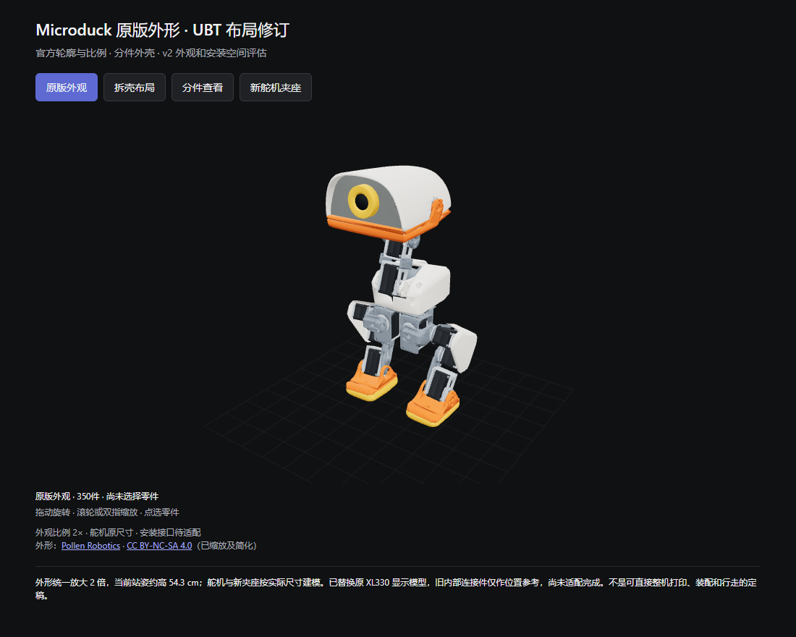
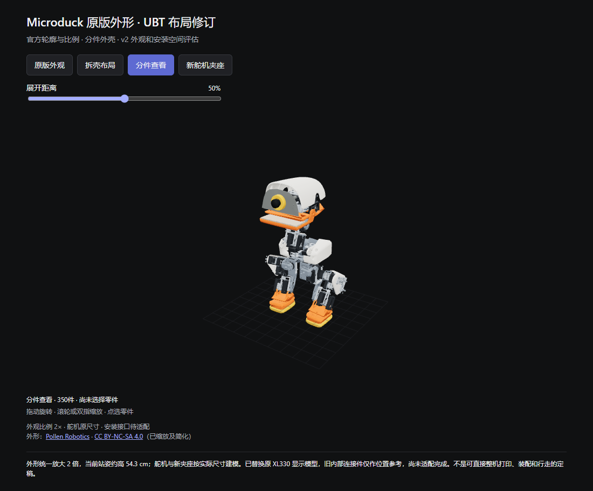

# Microduck 原版外形 · 低价舵机布局修订 v2

2026-10-26。基于 Microduck 官方外观的低成本舵机布局研究。此仓库由 microduck-original-look-v2.zip 整理，保留原始几何和报告，并修正了脚本依赖路径与报告中的本机路径。

**本版完成外形纠正与舵机安装空间评估，尚未完成整机连接件、驱动和实物试装。不是可直接采购、全套打印后行走的定稿。**

## 查看模型





下载或克隆本仓库后，用浏览器打开 `preview.html`。模型数据已经内嵌，三维显示库需要联网加载。GitHub 文件页不会直接运行此 HTML。

## 外观如何保持

直接使用 Pollen Robotics 官方公开模型的头罩、单目面板、上下嘴、左右胸壳、三角腿盖和脚底外形，统一等比例放大 2 倍，没有为了塞入舵机切掉这些外观网格。改动的是内部新舵机夹座、支架和候选安装位置。

当前采用官方 STAND 站姿，外观件包围尺寸为 **284.113 × 245.380 × 543.232 mm（宽 × 深 × 高）**。因此这是约 **54.3 cm 高的放大布局**，不是约 25 cm 的原尺寸复刻。官方标称身高和某个姿态网格的包围尺寸口径不同，不应混用。

轮廓保留：拱形头罩、中央单目、薄上下嘴、小胸壳、外露长颈、三角大腿盖、圆角厚脚底。默认白橙配色。外观网格并不包含全部真实制造公差；缩放也会放大原网格的壁厚和孔位，不能把外观参考 STL 当作已适配新电机的生产件。

## 新舵机与可拆设计

- 继续以 15 只 UBT-12HC 为候选，按已知 44 × 22.5 × 29 mm 外包络建立占位。舵机本体、螺钉与新夹座没有跟着外观放大。
- 移除了预览里的 15 只原 XL330 显示模型，换入 UBT 包络及新夹座。原电子器件和旧轴承显示模型也未假装按比例放大后继续使用。
- P01/P02 重做为窄夹座，宽度 36 mm；原侧耳改为上下布置的四个 M3 穿透紧固孔。两片可以分开，保留原装舵盘，不胶粘舵机。
- P03 底梁下移、侧板延长，与新上下螺钉凸台避让；增加内六角工具通道。P04/P05 舵盘适配仍采用待实测的占位尺寸。
- 为保持外壳不变，部分候选舵机位置进行了 1–6.5 mm 的局部移动。所有实际变换和偏移在 `motor-layout.json`。输出轴位置变化意味着原连杆、轴承座和安装孔不能直接沿用。
- 预览内灰色旧内部连杆是布局参考，名字带“待改接口”；它们与新夹座的刚性连接尚未设计完成。顶法兰也有尚未确定的连接孔。

“分件查看”展示独立零件和分离方向，不能代替实际工具可达性或无碰撞拆出路径验收。新夹座可以先单套试装，整机的完整可拆装性仍需在连接件完成后验证。

## 文件

| 路径 | 内容与用途 |
|---|---|
| `preview.html` | 可旋转整机、拆壳布局、分件和新舵机夹座；模型数据内嵌，联网只加载三维显示库 |
| `assembled.png` / `exploded.png` / `joint.png` | 真实模型截图，不是生成式效果图 |
| `cad/microduck-v2-layout.glb` | 带颜色的布局模型，供三维软件查看；不是制造装配约束模型 |
| `cad/exterior-study-stl/` | 17 种保持官方轮廓的 2× 外观参考网格，文件名明确带 REFERENCE；尚未重新设计壁厚和孔位 |
| `cad/adapter-step/` | 5 种新夹座/输出支架/待测舵盘转接实体；其中 P01–P03 为本轮重做 |
| `cad/adapter-stl/` | 对应试装网格，单位 mm；先试单套，不是全套机器人的生产文件 |
| `slim_cartridge.py` | 新 P01/P02/P03 的 CadQuery 源码 |
| `build_v2.py` | 外观、候选舵机摆放、静态空间检查和 GLB 的生成脚本 |
| `slim-cartridge-report.json` | 单件及单夹座检查结果 |
| `packaging-report.json` | 整体空间检查的精确范围及未验证项 |
| `parts-status.csv` | 每种几何体的数量和当前用途；不是完整采购 BOM |
| `source/` | 固定版本的官方参考及上一版夹座输入，不需重新下载即可重生成 |

## 已验证范围

1. 新 P01/P02/P03 均为有效单实体，STEP 回读成功；STL 闭合、单连通且法向一致。P01/P02 与新 P03 的静态实体交叠为 0，底部净距约 1.1 mm。检查基于候选外形与假定轴位，不证明真实 UBT 配合。
2. 新舵机/夹座与保持不变的外观网格，以及不同新关节模块彼此之间，中立姿态下未检出超过 **0.5 mm³** 的实体交叠。外观网格没有通过布尔切除来获得此结果。
3. 四种预览视图以及手机宽度已实际打开检查。
4. 17 个外观参考 STL 逐件与官方源网格的 2× 缩放比较，三角面数量一致、网格闭合，最大顶点误差约 0.000009 mm（STL 浮点导出误差）。完整记录见 `exterior-fidelity-report.json`。

检查未覆盖：旧内部连杆与新夹座的碰撞和连接、全部紧固件、同模块所有接触、接插件、运动包络、打印公差、强度、重量、扭矩和步态。**尤其不能将“空间未穿插”理解成“已经连接牢固、能站立、能行走”。**

外观 2× 网格的材料体积会随三维尺度增加，后续应在固定外表面的前提下重做内壁与加强筋，并通过切片估重。不能直接把厚壁参考网格作为最终打印方案。

## 预算约束保留

单只舵机仍以 **50 元为硬上限、30 元为预算目标**。目前没有核实当前在售、同型号、带原装舵盘且满足数量的报价。15 只按目标计 450 元、按上限计 750 元；这只是预算占位，整机 1000 元尚未落实。本轮没有购买或联系卖家。

## 重生成

建议使用 Python 3.12 创建独立环境，安装 `requirements.txt` 中的库后，在本目录执行。以 Ubuntu 为例：

```bash
python3.12 -m venv .venv
source .venv/bin/activate
python -m pip install -r requirements.txt
```

重生成命令：

```text
python slim_cartridge.py
python build_v2.py
python check_exterior.py
python prepare_preview.py
```

原报告中的旧 v1 P03 相交对比属于历史验证，所用旧 STEP 未随原 ZIP 附带；报告中已标记为外部参考。若需重复这一可选对比，将原旧 STEP 放到 `source/cartridge-v1/P03_output_yoke.step`，否则脚本跳过此项。新 P01/P02/P03 的生成和验证不依赖该文件。

采购复核：夹座试装螺钉应选 M3×30；预览中的 35 mm 长螺钉只是占位。被动轴、舵盘接口、完整内部连接仍待实物定型，不能按显示占位直接购买整机配件。

`slim_cartridge.py` 保留原 v1 模块局部坐标：输出轴是局部 Y，轴线经过 (0,0,11)。官方 XL330 的轴是局部 X，经过原点；转换及驱动侧假设记录在 `source/official/motor-frame-report.json`。不能把两种坐标直接叠加。

预览几何有简化，坐标显示精度为 0.1 mm；交叠检查使用独立的较高精度输入网格，外观参考 STL 和夹座 STEP 不受显示简化影响。

## 来源、署名与许可

原始外观与模型作者：**Pollen Robotics**。

- 固定来源：https://github.com/pollen-robotics/microduck_rl/tree/b02fdea4902c2b93b7d34a83a6f05da4ececb7d3
- 模型许可：https://github.com/pollen-robotics/microduck_rl/blob/b02fdea4902c2b93b7d34a83a6f05da4ececb7d3/LICENSE-MODELS.md
- 许可说明：https://creativecommons.org/licenses/by-nc-sa/4.0/
- 外观照片核对：https://pollen-robotics.com/microduck/

官方 STL 及其缩放、简化、组装等衍生网格按 **CC BY-NC-SA 4.0** 署名、非商业、相同方式共享。本包已注明修改：2× 缩放、站姿变换、显示简化、配色调整及替换候选舵机。保留了原 `LICENSE-MODELS.md`；不能把模型一概写成 Apache-2.0。XML/配置的 Apache-2.0 许可见原 `LICENSE`。
